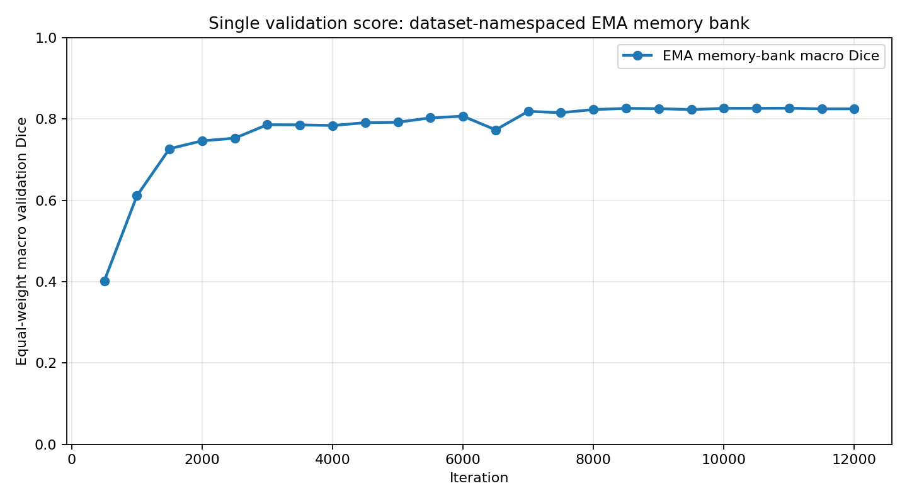
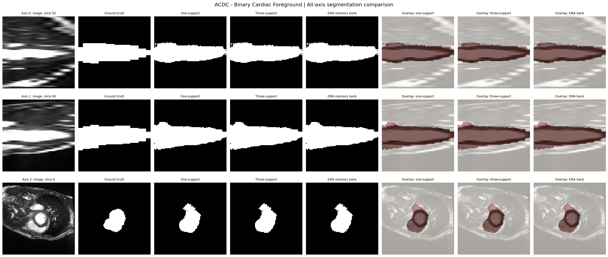
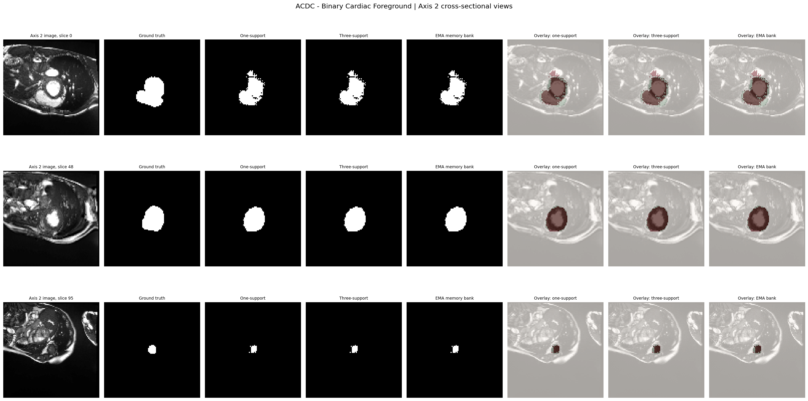
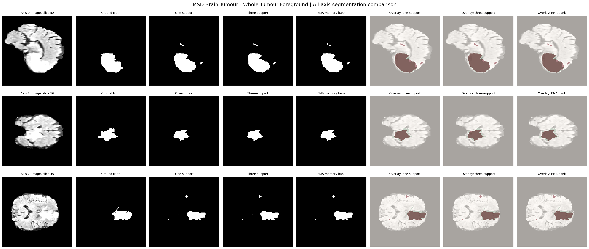
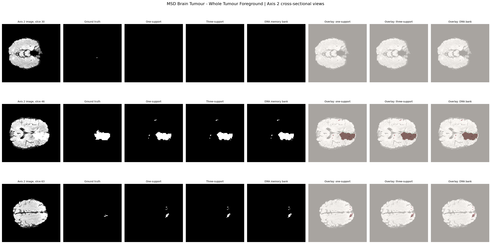

# IRIS: 3D Medical Segmentation with Dataset-Specific EMA Task Memory

An independent, **IRIS-inspired episodic 3D segmentation implementation** that compares support-conditioned prediction with **support-free retrieval from separate EMA task memories** for ACDC cardiac foreground and MSD Brain Tumour whole-tumour segmentation.

The implementation draws on the in-context task-encoding and reference-guided decoding ideas in *Show and Segment: Universal Medical Image Segmentation via In-Context Learning* (CVPR 2025). It is an independent implementation, not an official reproduction of the paper or its full evaluation protocol.

## Experiment

The current experiment is binary:

| Dataset | Binary foreground target |
|---|---|
| ACDC | Original labels 1 (RV), 2 (myocardium) and 3 (LV) are merged into one cardiac-foreground mask. |
| MSD Brain Tumour | All non-zero tumour labels are merged into one whole-tumour mask. |

Both datasets use a single input channel in this experiment. Results therefore measure the foreground unions; they do not measure individual cardiac structures or tumour subregions.


## Model

The implementation has four main stages:

1. **3D feature encoder.** A residual 3D U-Net-style encoder extracts volumetric features at five scales.
2. **Mask-guided task encoding.** A support mask is used to pool foreground features. A contextual branch fuses the mask with pixel-shuffled features, then learned query tokens attend to the contextual representation.
3. **Task-conditioned decoder.** Bidirectional cross-attention connects task tokens and query features. A residual decoder uses skip connections and FiLM feature modulation to produce a binary mask.
4. **Dataset-specific EMA task memory.** A persistent task embedding is maintained separately for each dataset and can be retrieved to segment a query without encoding a new labelled support image.

### Task embeddings

For the documented configuration, the encoder has 256 channels at its deepest stage. The task encoder produces one pooled foreground token and eight learned contextual tokens, giving a **9 × 256** task embedding per binary task.

The contextual branch uses the encoder's 16× spatial downsampling ratio. With 256 feature channels, the implementation computes:

```math
C_{\text{context}} =
\max\left(
1,
\left\lceil \frac{256}{16^3} \right\rceil
\right) = 1.
```

### EMA memory

The built-in `ClassMemoryBank` is keyed by integer IDs. Since both datasets use local foreground label `1` but represent different tasks, this experiment assigns separate memory keys:

| Dataset | Segmentation label | EMA memory key |
|---|---:|---:|
| ACDC cardiac foreground | 1 | 101 |
| MSD Brain Tumour whole tumour | 1 | 201 |

For task embedding \(E_t\), the memory update is:

```math
M_t = \mu M_{t-1} + (1-\mu)E_t,
\qquad \mu = 0.90.
```

Only detached support embeddings from training episodes update the bank, and only after a successful optimizer step. Validation and test do not update it. At bank-inference time, the runner retrieves the stored embedding associated with the selected dataset/task and sends it to the query decoder. This is support-free inference for **tasks already represented in the training memory**; it is not inference on an unseen task or unseen dataset.

## Evaluation protocol

The runner compares three inference strategies on the same sampled query episodes:

- **One support:** encode one labelled support volume and use its task embedding.
- **Context ensemble:** encode three distinct labelled support volumes and average their task embeddings.
- **EMA memory:** retrieve the persistent dataset-specific embedding without using a query-specific support.

Training uses one support and a different query subject per episode. ACDC frames are grouped by patient for splitting and support/query sampling, preventing different frames from one patient being treated as independent subjects. Validation episode sampling is fixed across checkpoints. Both datasets are used during training, so this experiment is a within-dataset held-out-subject evaluation, not unseen-dataset generalization.

The Dice metric is:

```math
\operatorname{Dice}(P,G) =
\frac{2|P \cap G|+\epsilon}
{|P|+|G|+\epsilon}.
```

where \(P\) is the predicted foreground and \(G\) is the ground-truth foreground. The reported macro score first averages episode Dice within each dataset and then gives the two datasets equal weight:

```math
D_{\text{macro}} =
\frac{D_{\text{ACDC}}+D_{\text{Brain Tumour}}}{2}.
```

This is an equal-weight average of dataset scores, not a pooled voxel-wise Dice.

## Training configuration

| Parameter | Documented value |
|---|---:|
| Volume size | 96 × 96 × 96 |
| Input channels | 1 |
| Base channels | 16 |
| Encoder downsampling stages | 4 (total factor 16) |
| Encoder channel widths | 16, 32, 64, 128, 256 |
| Learned contextual query tokens | 8 (+ 1 pooled foreground token) |
| Training iterations | 12,000 |
| Validation interval | 500 iterations |
| Validation episodes | 20 per dataset |
| Test episodes | 30 per dataset |
| Training supports / evaluation ensemble supports | 1 / 3 |
| Optimizer | LAMB |
| Initial learning rate | 1e-4 |
| LAMB betas / epsilon | (0.9, 0.999) / 1e-6 |
| Weight decay | 1e-5 |
| Gradient clipping | 1.0 maximum norm |
| Learning-rate schedule | Cosine annealing; minimum LR 1e-6 |
| Loss | Soft Dice loss + binary cross-entropy with logits |
| EMA momentum | **0.90** |
| Split | 70% train / 15% validation / 15% test |
| Split seed | 42 |
| Mixed precision | Enabled |

Images are resized to the target volume size using cubic interpolation; masks use nearest-neighbour interpolation. MRI intensities are percentile-clipped (1st–99th percentile), normalized, foreground-standardized and clipped to the configured range. No original image spacing target is specified in the documented run.

## Visual results

The repository snapshot contains one validation graph and four prediction montages, stored under `assets/`. Overlays use **green for ground truth** and **red for prediction**. The cross-sectional montages show array axis 2; axis labels refer to the preprocessed array, not a guaranteed anatomical orientation. Each montage is a saved test episode, not a review of every test subject.

### Validation

**Equal-weight macro validation Dice using EMA memory retrieval.** The selected checkpoint is chosen using this validation metric.



### ACDC — cardiac foreground union

**All-axis comparison:** image, ground truth, one-support, three-support and EMA-memory predictions.



**Axis-2 cross-sectional views:** representative slices through the cardiac foreground.



### MSD Brain Tumour — whole-tumour union

**All-axis comparison:** image, ground truth and the three inference strategies.



**Axis-2 cross-sectional views:** representative slices through the whole-tumour foreground.



## Repository layout

```text
.
├── README.md
├── .gitignore
├── assets/                          # One validation graph and four prediction montages
├── scripts/training/
│   └── train_iris_acdc_brain_binary_ensemble_memory_bank.py
└── src/iris/
    ├── data/                        # Volume I/O, preprocessing and dataset adapters
    ├── model/                       # Encoder, task encoder, decoder and EMA memory
    └── training/                    # LAMB optimizer and training utilities
```

The dataset files, model checkpoints and serialized memory-bank tensors are not included. The runner expects the complete `src/iris/` package and a local dataset root.

## Setup and run

Install a CUDA-compatible PyTorch build for your system first. Then install the remaining dependencies:

```powershell
python -m venv .venv
.\.venv\Scripts\Activate.ps1
python -m pip install --upgrade pip
pip install numpy scipy nibabel matplotlib
```

`SimpleITK` is only needed if you load MHD/MHA files; the supplied ACDC and MSD loaders use NIfTI files. Place the datasets in the following layout (dataset contents are not included):

```text
datasets/
├── acdc/
└── msd_brain_tumor/
```

Run a short pipeline check:

```powershell
python -m py_compile scripts/training/train_iris_acdc_brain_binary_ensemble_memory_bank.py
python scripts/training/train_iris_acdc_brain_binary_ensemble_memory_bank.py `
  --dataset-root datasets `
  --datasets acdc msd_brain_tumor `
  --smoke-test `
  --resolution 32 `
  --eval-shots 3 `
  --memory-momentum 0.90 `
  --output-dir outputs/iris_ema_memory_smoke32
```

Reproduce the documented run:

```powershell
python scripts/training/train_iris_acdc_brain_binary_ensemble_memory_bank.py `
  --dataset-root datasets `
  --datasets acdc msd_brain_tumor `
  --iterations 12000 `
  --eval-every 500 `
  --val-episodes 20 `
  --test-episodes 30 `
  --eval-shots 3 `
  --resolution 96 `
  --memory-momentum 0.90 `
  --output-dir outputs/iris_acdc_brain_binary_ema_memory96_run12000
```

Pass `--memory-momentum 0.90` explicitly: the runner's CLI default is `0.999`, while the documented experiment used `0.90`.


## Reference

Gao, Y. et al. (2025). *Show and Segment: Universal Medical Image Segmentation via In-Context Learning*. Proceedings of the IEEE/CVF Conference on Computer Vision and Pattern Recognition (CVPR).

- [CVPR paper](https://openaccess.thecvf.com/content/CVPR2025/html/Gao_Show_and_Segment_Universal_Medical_Image_Segmentation_via_In-Context_Learning_CVPR_2025_paper.html)
- [arXiv:2503.19359](https://arxiv.org/abs/2503.19359)
